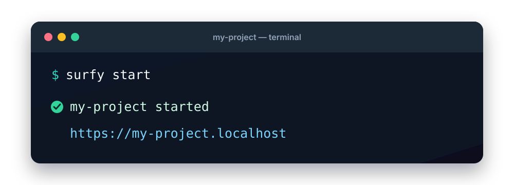
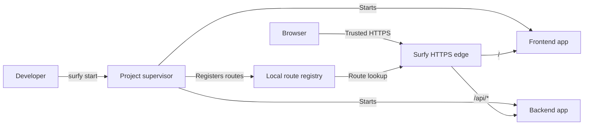

# Surfy

[](https://github.com/tankibaj/surfy/actions/workflows/ci.yml)
[](https://github.com/tankibaj/surfy/releases/latest)

**Give every local app a stable, trusted HTTPS address.**

Surfy runs your frontend and backend together at a memorable `.localhost` URL—without port hunting, certificate warnings, or separate process-manager setup.

[More about Surfy](https://thenaim.com/projects/surfy/)

```text
https://my-project.localhost          → frontend
https://my-project.localhost/api/*    → backend, path preserved
```

## Quick start

Surfy currently supports Apple Silicon Macs (M1 or newer) and installs through Homebrew.

```sh
# 1. Install Surfy
brew tap tankibaj/surfy https://github.com/tankibaj/surfy
brew install tankibaj/surfy/surfy

# 2. Set up trusted local HTTPS once
surfy install

# 3. Start a project
cd path/to/my-project
surfy init
surfy start
```



Open the URL Surfy prints, or run `surfy open` to launch it in your browser.

`surfy install` requests macOS administrator authorization to install the shared HTTPS edge and trust Surfy's private local certificate authority. Project processes still run as your normal user.

### Already have a manifest?

Create `surfy.yaml` in the project root, then run `surfy start`:

```yaml
web: ./frontend
api: ./backend
```

The directory name becomes the hostname by default. Add `name: my-app` to choose a different one.

## How it works



One root-owned edge listens only on `127.0.0.1:80` and `127.0.0.1:443`. Each project gets an unprivileged supervisor that starts its services on available loopback ports and registers their routes. The edge terminates TLS and sends each request to the correct project service.

## What Surfy detects

| Runtime | Automatic behavior |
| --- | --- |
| Node.js | Detects package-manager metadata and runs `dev` or `start`; Vite receives loopback host and port flags. |
| Python | Detects Django, Flask, and FastAPI; local `.venv` or `venv` executables are preferred. |
| Go | Runs the project with `go run .`. |
| Anything else | Use an explicit `run` command with `${PORT}` in `surfy.yaml`. |

Example with an explicit backend command:

```yaml
name: storefront
web: ./frontend
api:
  path: ./backend
  run: ./.venv/bin/uvicorn app.main:app --host 127.0.0.1 --port ${PORT} --reload
  env:
    ENV_FILE: ./.env
```

Surfy passes environment values directly to child processes and never stores resolved secrets in its registry.

### Project dependencies and lifecycle hooks

Use ordered lifecycle hooks when a project needs local infrastructure such as
PostgreSQL or Redis:

```yaml
name: storefront

before_start:
  - docker compose up -d --wait database
  - npm run db:migrate

after_stop:
  - docker compose stop database

web: ./frontend
api: ./backend
```

Hooks run from the directory containing `surfy.yaml` and inherit the environment
used to launch Surfy. `before_start` runs before either application service and
stops at the first failure. `after_stop` runs after application services exit
and attempts every command even if an earlier cleanup command fails. Each hook
phase has a 60-second timeout. `surfy restart` runs `after_stop`, followed by
`before_start` as part of the new start.

Lifecycle hooks execute arbitrary shell commands with the current user's
permissions. Keep secrets in the environment rather than writing them in the
manifest. Avoid stopping shared infrastructure from `after_stop`; only manage
dependencies owned by that project.

## Everyday commands

```text
surfy                                  Run the current project in the foreground
surfy init                             Create surfy.yaml from detected services
surfy start [project-name|path]        Start a project in the background
surfy stop [project-name|path]         Stop a project
surfy restart [project-name|path]      Restart a project
surfy status [project-name|path]       Show project and service status
surfy logs [project-name|path]         Print combined project logs
surfy logs [project-name|path] api -f  Follow only backend logs
surfy open [project-name|path]         Open the project URL
surfy list                             List registered projects
```

Run `surfy help` for the complete command reference, including login startup and certificate management.

## Start projects at login

```sh
surfy enable my-project
surfy disable my-project
```

Enabled projects run after you sign in, under your user account.

## Troubleshooting

```sh
surfy doctor
surfy status
surfy logs
surfy certificate status
surfy certificate repair
```

State is stored in `~/Library/Application Support/surfy`, with logs in `~/Library/Logs/surfy`.

## Uninstall

```sh
surfy uninstall --remove-ca
brew uninstall surfy
brew untap tankibaj/surfy
```

Omit `--remove-ca` if you want to preserve the local certificate authority for a later reinstall.

## Migrating from the predecessor

Surfy 0.1 is a clean break and does not automatically migrate predecessor services, state, environment variables, or manifests. Remove the previous edge service with its original CLI before installing Surfy, then rename project manifests to `surfy.yaml`.

## For contributors

```sh
make check
make build-apple-silicon
```

Successful CI on `main` publishes an unpublished version, creates its GitHub tag and release, and writes the release checksum back to the Homebrew formula.
