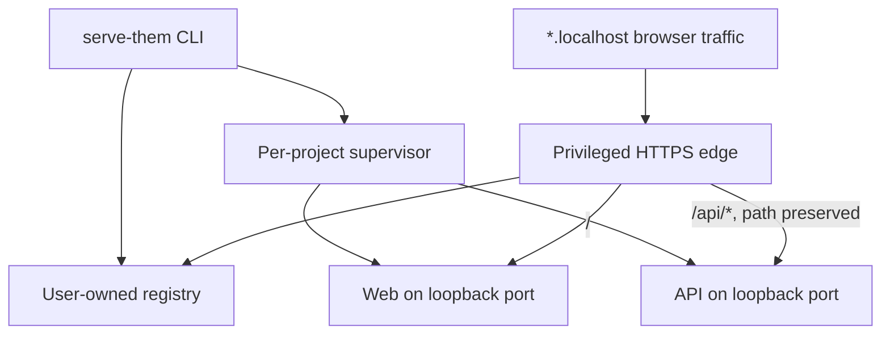

# Serve Them MVP

**Status:** Blocked | **Owner:** main-agent | **Updated:** 2026-08-06 21:36

Blocked: Codex's mandatory GitHub network approval service returns HTTP 404; local `gh` execution cannot access the authenticated Keychain session.

## Goal

Deliver the Apple Silicon-first `serve-them` MVP described in the supplied product specification: runtime detection, unprivileged project supervision, stable HTTPS `.localhost` routing, background lifecycle, local certificates, logs, and login startup.

## Scope

- Dependency-free Go CLI and restricted `serve.yaml` parser.
- Native `darwin/arm64` release build optimized for M1 and newer Macs; retain portable seams for later Linux support.
- Homebrew tap formula, Linux-hosted CI verification/cross-build, and locally produced native ARM64 release archive.
- Node.js, Python, Go, and explicit-command detection.
- Per-project supervisors with loopback port allocation and readiness checks.
- Shared privileged edge on ports 80/443, per-host TLS, path-preserving `/api` dispatch, WebSockets, and HTTP redirect.
- macOS CA trust, LaunchDaemon edge installation, and per-user LaunchAgent project startup.
- Registry, status, logs, collision handling, diagnostics, and uninstall.
- Unit and integration-level verification; no browser UI exists, so Playwright is not applicable.

## Architecture

## Affected Files

- `cmd/serve-them/main.go`
- `internal/app`, `internal/cert`, `internal/detect`, `internal/edge`, `internal/manifest`, `internal/state`, `internal/supervisor`
- `README.md`, `CLAUDE.md`, `Makefile`, `.gitignore`
- `.github/workflows/ci.yml`, `Formula/serve-them.rb`

## Test Strategy

- Unit tests for manifest parsing/security validation, runtime detection, certificate chains, and state behavior.
- Integration tests for edge route selection, `/api` rewriting, redirects, and unavailable-service responses.
- Isolated-state CLI smoke tests for build/help/doctor and foreground/background lifecycle using fixture HTTP services.
- Separate test-runner verification of the full suite after implementation.

## Definition of Done

- [x] CLI and manifest surface implemented.
- [x] Runtime detection and dynamic loopback ports implemented.
- [x] Local CA, host certificates, and shared HTTPS edge implemented.
- [x] Foreground/background lifecycle, registry, status, logs, and hostname collisions implemented.
- [x] macOS edge installer and login startup implemented.
- [x] Crash restart policy and functional log following verified.
- [x] Security review findings resolved (0 P0/P1).
- [x] Full suite passes under a sandbox-safe Go cache (16/16).
- [x] User and agent documentation matches the shipped surface.
- [x] Homebrew formula checksum matches the local v0.1.0 asset.
- [ ] Changes committed and pushed to `github.com/tankibaj/server-them` with CI configured.
